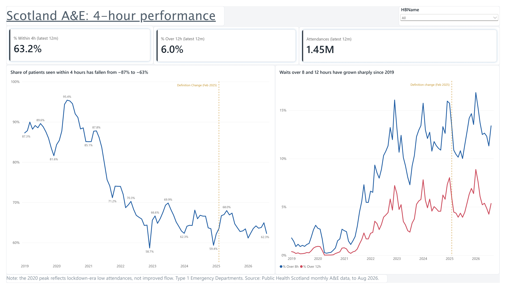
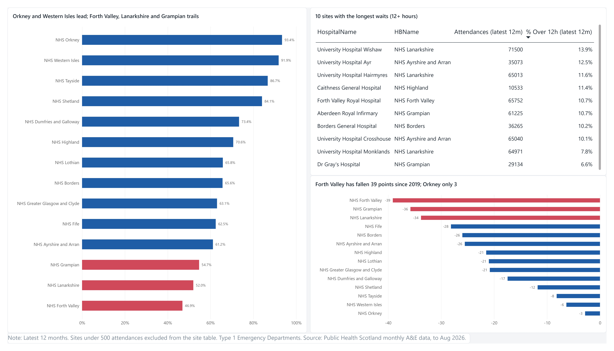
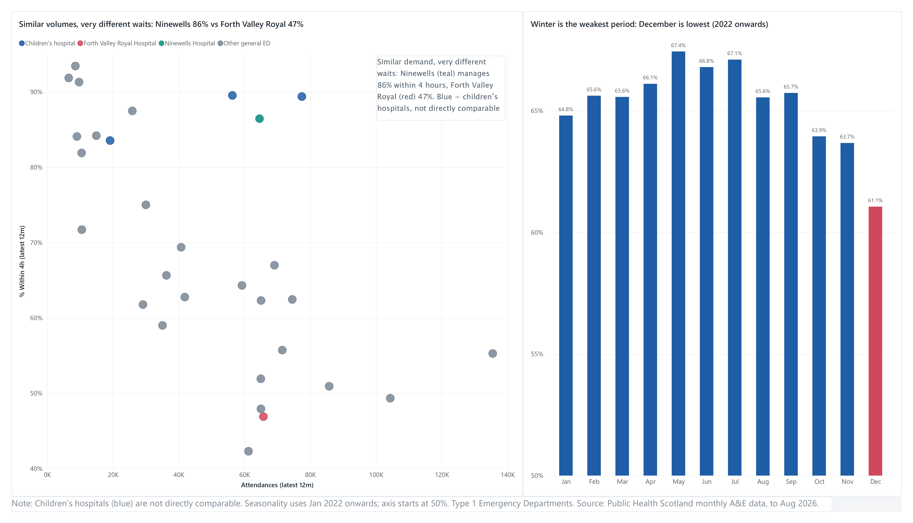

# Scottish A&E Waiting Times: An End-to-End Business Analysis

**Where are Scotland's Emergency Departments struggling most, and what should operations managers do about it?**
A business analysis built the way a BA engagement runs: problem statement, stakeholders, requirements and user stories, then SQL analysis, a Power BI dashboard and a recommendation memo.

> Data: Public Health Scotland monthly A&E data, Type 1 Emergency Departments, to August 2026.

## Headline findings
| Finding | Evidence |
|---|---|
| Four-hour performance has fallen sharply | About **87% in 2019 to 63%** over the latest 12 months |
| Long waits have grown | Patients waiting over 12 hours: **0.4% (Jan 2019) to 6.0%** (latest 12 months) |
| Boards differ widely | Orkney 93% and Western Isles 92%, against Grampian 55%, Lanarkshire 52% and **Forth Valley 47%** |
| The weakest boards fell furthest | Since 2019: Forth Valley **-39 points**, Grampian -36, Lanarkshire -34. Orkney only -3 |
| Long waits are concentrated | Wishaw, Ayr and Hairmyres have the highest share waiting over 12 hours. Lanarkshire has three of the worst ten sites |
| Demand does not explain the gap | Ninewells and Forth Valley Royal each handle about 65,000 attendances a year. Ninewells sees about 86% within 4 hours, Forth Valley Royal 47% |
| Winter is weakest | Since 2022, December averages 61.1% within 4 hours, against 67.4% in May |

Full write-up with recommendations: [`05_findings/recommendation_memo.md`](05_findings/recommendation_memo.md)

## Dashboard
Built in Power BI. Download the [PDF version](04_dashboard/ae_dashboard.pdf) or open the [.pbix](04_dashboard/ae_dashboard.pbix).

**1. Overview:** national 4-hour performance, long-wait trend, and key measures for the latest 12 months.


**2. Boards and sites:** board ranking, ten sites with the longest waits, and each board's fall since 2019.


**3. Demand vs flow:** attendances against 4-hour performance for every site, and the seasonal pattern.


## Approach
1. **Business analysis** ([`01_business/`](01_business)): problem statement, stakeholder map, requirements document (BRD) with MoSCoW priorities, and 8 user stories with acceptance criteria.
2. **Data preparation** ([`clean_data.py`](clean_data.py)): joined health board and hospital names, kept one attendance category, converted dates, loaded a SQLite database.
3. **SQL analysis** ([`03_sql/`](03_sql)): one query per user story. Each file names the story it answers.
4. **Dashboard** ([`04_dashboard/`](04_dashboard)): three pages built for an operations manager.
5. **Recommendation memo** ([`05_findings/`](05_findings)): finding, so what, recommendation, indicative impact, limitations.

## Judgement calls and data traps
- **Double counting.** The data has Unplanned, New planned and All rows. All is the sum of the other two, so adding them would count patients twice. Only "All" is used.
- **8- and 12-hour waits exist for Emergency Departments only.** Minor injury units have no such data, so the analysis is Type 1 only.
- **Percentages are calculated from summed counts, never averaged.** Averaging site percentages would let small sites distort national figures.
- **Small sites are excluded from rankings** (under 500 attendances in the period) because small numbers swing percentages.
- **Children's hospitals are flagged.** They are not directly comparable with general Emergency Departments.
- **Definition change.** Planned attendances joined the 4-hour standard in February 2025, so the trend charts mark that date.
- **Unnamed sites.** 15 site codes have no name in the PHS hospital list (likely closed or renamed). They are labelled "Unknown site" and reported, not dropped.
- **Covid distortion.** The 2020 peak reflects low attendances during lockdown, not better flow. The seasonality chart starts at 2022 for this reason.
- **Truncated axis disclosed.** The seasonality chart's axis starts at 50% to make a 6-point gap visible, and says so.

## Tools
Python (pandas), SQLite, SQL, Power BI (DAX measures), Git and GitHub. Claude Code was used for coding help; the analysis design, business documents and conclusions are my own.

## What I'd do next
- **Test the "flow, not demand" hypothesis** with bed occupancy, delayed discharge and staffing data by site. This analysis shows where and when, not why.
- **Peer review.** Compare patient-flow practice at Ninewells with Forth Valley Royal and Wishaw.
- **Automate the refresh.** A scheduled script to pull each new month's PHS release and update the dashboard.
- **Add a winter forecast** so boards can plan staffing before October.
- **Reconcile with the official PHS monthly publication** to confirm every figure matches.
- **Extend to Type 3 services** (minor injury units) for the full A&E picture.

## Repository structure
```
├── 01_business/     problem statement, stakeholder map, BRD, user stories
├── 02_data/
│   ├── raw/         original PHS files (unchanged)
│   └── clean/       ae_clean.csv and ae.db (SQLite)
├── 03_sql/          one query per user story
├── 04_dashboard/    Power BI file, PDF and page screenshots
├── 05_findings/     recommendation memo
└── clean_data.py    data preparation script
```

## Reproduce it
1. Install Python 3.13 and pandas: `py -3.13 -m pip install pandas`
2. From the project folder: `py -3.13 clean_data.py`
3. This writes `02_data/clean/ae_clean.csv` and the `ae_monthly` table in `02_data/clean/ae.db`.
4. Run the queries in `03_sql/` in any SQLite tool. Open `04_dashboard/ae_dashboard.pbix` in Power BI Desktop (it reads `ae_clean.csv`; refresh the data source path if needed).

## Data source and licence
Public Health Scotland, [Monthly A&E Activity and Waiting Times](https://www.opendata.nhs.scot/dataset/monthly-accident-and-emergency-activity-and-waiting-times) and the hospital and health board lookups from the same open data portal.
Contains public sector information licensed under the [Open Government Licence v3.0](https://www.nationalarchives.gov.uk/doc/open-government-licence/version/3/).
This is an independent portfolio analysis of published statistics. It is not an official PHS publication or a statement of compliance with the national standard.

## About
Kumar Lakshya, MBA (University of Glasgow, Adam Smith Business School), with a background in strategy, business analysis and project engineering.
LinkedIn: https://www.linkedin.com/in/kumarlakshya9600
